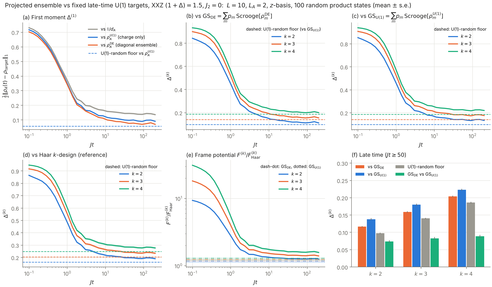

# Deep thermalization in the XXZ chain

Numerics for the **projected ensemble** of the XXZ spin-1/2 chain after a quench from random product
states. The question is whether signatures of integrability survive in the higher moments
$k\ge 2$ of the projected ensemble, beyond the first moment (the reduced density matrix).

## Contents

- [Setup](#setup)
- [Repository layout](#repository-layout)
- [Quick start](#quick-start)
- [What is computed](#what-is-computed)
- [Output files](#output-files)
- [Results so far](#results-so-far)
- [Conventions and gotchas](#conventions-and-gotchas)
- [Next steps](#next-steps)

---

## Setup

**Hamiltonian** (Pauli matrices, open boundaries):

$$
H = -J\sum_{i=1}^{L-1}\Big(X_iX_{i+1}+Y_iY_{i+1}+(1+\Delta)\,Z_iZ_{i+1}\Big)
\;-\;J_2\sum_{i=1}^{L-2}\Big(X_iX_{i+2}+Y_iY_{i+2}+(1+\Delta)\,Z_iZ_{i+2}\Big).
$$

- $J_2=0$: integrable XXZ. $\Delta=-1$ is the free-fermion XX point, and $\Delta=0$ is the $SU(2)$-symmetric XXX point.
- $J_2\neq 0$: breaks integrability but keeps the $U(1)$ symmetry $Q=\sum_i Z_i$.

**Protocol.**

1. Prepare $|\psi_0\rangle=\bigotimes_j|\hat n_j\rangle$, with each $\hat n_j$ drawn uniformly on the Bloch sphere.
2. Evolve to $|\psi(t)\rangle=e^{-iHt}|\psi_0\rangle$ with Krylov (Lanczos) time stepping.
3. Split the chain into $A$ (sites $1..L_A$, at one end of the chain) and the bath $B$ (sites $L_A+1..L$).
4. Measure $B$ projectively in the $z$-basis. This gives the projected ensemble
   $\mathcal P=\{p(z_B),\,|\psi_A(z_B)\rangle\}$ and its moments

$$
\rho^{(k)}_{\mathcal P}=\sum_{z_B}p(z_B)\,\big(|\psi_A(z_B)\rangle\langle\psi_A(z_B)|\big)^{\otimes k}.
$$

---

## Repository layout

| File | Language | What it does |
|---|---|---|
| [`src/DeepTherm.jl`](src/DeepTherm.jl) | Julia | **Core module.** Hamiltonian, random/Haar states, Krylov evolution, projected-ensemble moments, exact Scrooge moments, $U(1)$ targets, diagonal ensemble, trace distances |
| [`run_u1_scrooge.jl`](run_u1_scrooge.jl) | Julia | **Main analysis.** Distances to *fixed* late-time $U(1)$ generalized-Scrooge targets for one model |
| [`run_projected_ensemble.jl`](run_projected_ensemble.jl) | Julia | First exploratory run: several models against Haar and *instantaneous* Scrooge targets (see the [caveat below](#instantaneous-vs-fixed-targets)) |
| [`sanity_checks.jl`](sanity_checks.jl) | Julia | Unit checks: Hamiltonian vs a dense Pauli construction, Krylov vs `exp`, Scrooge vs Haar and vs Monte Carlo |
| [`plot_u1_targets.py`](plot_u1_targets.py) | Python | Figure for `run_u1_scrooge.jl` output |
| [`plot_time_evolution.py`](plot_time_evolution.py) | Python | Figure for `run_projected_ensemble.jl` output |
| `Project.toml`, `Manifest.toml` | — | Pinned Julia environment (KrylovKit, QuadGK) |
| [`results/`](results/) | — | CSVs, logs and figures from the runs listed under [Results so far](#results-so-far) |

### Functions in `src/DeepTherm.jl`

| Function | Purpose |
|---|---|
| `build_hamiltonian(L; J, Δ, J2, h)` | Sparse $H$ with the conventions above, plus optional $\sum_i h_iZ_i$ |
| `random_product_state(rng, L)`, `haar_state(rng, L)` | Initial states and benchmark states |
| `evolve_measure(H, ψ0, times, f)` | Krylov evolution (`KrylovKit.exponentiate`); returns `f(ψ(t))` at each time |
| `pe_moment(Ψ, p, k)` | $\rho^{(k)}_{\mathcal P}$ from the $d_A\times d_B$ reshaped state |
| `scrooge_moment(ρ, k, S)` | **Exact** $k$-th moment of Scrooge$[\rho]$ (no sampling, see below) |
| `diagonal_ensemble_rhoA`, `diagonal_ensemble_conditioned` | Infinite-time-averaged $\rho_A$, and its $Q_B$-resolved version $\{p_m,\rho_m^{\rm DE}\}$ (needs full ED) |
| `u1_conditioned(ψ0, LA, L)` | $U(1)$ max-entropy decomposition $\{p_m,\rho_m^{U(1)}\}$ |
| `gs_moment(cond, k, S)` | Generalized Scrooge moment $\sum_m p_m\,\mathrm{Scrooge}[\rho_m]^{(k)}$ |
| `u1_random_state(rng, ψ0, L)` | Haar-random inside each charge sector with the same $P(N)$: the finite-size floor |
| `measure_all(ψ, LA, L, cache; basis)` | All distances used by `run_projected_ensemble.jl` |

---

## Quick start

**Requirements.** Julia ≥ 1.10 (developed on 1.11.5). For plotting, Python 3 with `numpy`, `pandas` and `matplotlib`.

```bash
git clone https://github.com/uditvarma/deep-therm-xxz.git
cd deep-therm-xxz
julia --project=. -e 'using Pkg; Pkg.instantiate()'

# 1. check that everything is correct (~30 s)
julia --project=. sanity_checks.jl

# 2. main analysis: fixed U(1) targets
#    arguments: L  L_A  n_realizations  Δ  J2        (Δ = 0.5 means 1+Δ = 1.5)
julia --project=. -t auto run_u1_scrooge.jl 10 2 100 0.5 0.0
python3 plot_u1_targets.py results/u1_raw_L10_LA2_n100_D0.5_J20.0.csv

# integrability-broken comparison (same initial states, same seeds)
julia --project=. -t auto run_u1_scrooge.jl 10 2 100 0.5 0.5
python3 plot_u1_targets.py results/u1_raw_L10_LA2_n100_D0.5_J20.5.csv \
        results/u1_time_evolution_L10_LA2_n100_D0.5_J20.5.png '$J_2=0.5$'
```

Parallelism is over realizations (`Threads.@threads`). BLAS is pinned to one thread inside each worker,
so pass `-t N` to use $N$ cores.

**Runtime.** $L=10$, $L_A=2$, 100 realizations and 31 time points take about 100 s on 2 cores.
Most of the cost is the $k=4$ moments: $\rho^{(4)}$ is $d_A^4\times d_A^4 = 256\times256$ for $L_A=2$.
The cost grows like $d_A^{2k}$, so $L_A=3$ at $k=4$ is about 256× more expensive per time point.

---

## What is computed

### Distance measure

For every realization and every time,

$$
\Delta^{(k)}(t)=\tfrac12\big\|\rho^{(k)}_{\mathcal P}(t)-\rho^{(k)}_{\rm target}\big\|_1 .
$$

Plotted curves are the mean over realizations. Each realization is compared with its own target.
The scripts also compute the frame-potential ratio
$F^{(k)}/F^{(k)}_{\rm Haar}=\operatorname{tr}\big[(\rho^{(k)}_{\mathcal P})^2\big]\binom{d_A+k-1}{k}$.

### Targets

Throughout, $m$ is the number of down spins measured in $B$, which fixes $Q_B$.

| Name in code | Target | Meaning |
|---|---|---|
| `haar` | $\Pi_{\rm sym}^{(k)}/\binom{d_A+k-1}{k}$ | Haar $k$-design. Reference only: it ignores both the first moment and the symmetry |
| `gsU1` | $\sum_m p_m\,\mathrm{Scrooge}[\rho_m^{U(1)}]^{(k)}$ | **$U(1)$ maximum-entropy prediction.** Global state uniformly random within each charge sector $N$, with the initial state's $P(N)$. Then $\rho_m^{U(1)}\propto\sum_{n_A}P(n_A+m)\binom{L_B}{m}\binom{L}{n_A+m}^{-1}\Pi^A_{n_A}$ |
| `gsDE` | $\sum_m p_m\,\mathrm{Scrooge}[\rho_m^{\rm DE}]^{(k)}$ | **Exact stationary first moment, $Q_B$-resolved**: $\rho_m^{\rm DE}\propto\operatorname{Tr}_B[(\mathbb 1\otimes\Pi^B_m)\rho_{\rm DE}]$ with $\rho_{\rm DE}=\sum_E P_E\vert\psi_0\rangle\langle\psi_0\vert P_E$. Contains energy and integrable-charge information |
| `scr`, `gs` | Same constructions built from the **instantaneous** $\rho_A(t)$ and $\rho_m(t)$ | Only in `run_projected_ensemble.jl` (see the caveat below) |

**Floor.** Distances never reach zero at finite $d_B$. The benchmark is a `u1_random_state` with the same
$P(N)$, measured against its own `gsU1` target. In the older script, the benchmark is a Haar-random global state.

### Exact Scrooge moments

Scrooge$[\rho]$ is the ensemble of normalized states $h/\|h\|$, with $h\sim\mathcal{CN}(0,\rho)$ and weight $\|h\|^2$.
Write $\rho=U\,\mathrm{diag}(\lambda)\,U^\dagger$. Using
$\|h\|^{-2(k-1)}=\frac{1}{(k-2)!}\int_0^\infty s^{k-2}e^{-s\|h\|^2}\,ds$ together with Wick's theorem gives

$$
\mathrm{Scrooge}[\rho]^{(k)}=U^{\otimes k}\,D\,\Big(\sum_{\pi\in S_k}P_\pi\Big)\,U^{\dagger\otimes k},
\qquad
D_{i_1\dots i_k}=\frac{1}{(k-2)!}\int_0^\infty\! ds\;s^{k-2}\prod_{i=1}^{d}\frac{1}{1+s\lambda_i}\prod_{j=1}^{k}\frac{\lambda_{i_j}}{1+s\lambda_{i_j}},
$$

valid for $k\ge 2$. The integral is evaluated with `QuadGK`. `sanity_checks.jl` verifies three properties:
Scrooge$[\mathbb 1/d]$ equals Haar exactly, the partial trace returns $\rho$, and the formula agrees with Monte Carlo sampling.

### Instantaneous vs fixed targets

`run_projected_ensemble.jl` builds its Scrooge targets from $\rho_A(t)$ at the same time $t$.
Those targets move with the data, so $\Delta^{(k)}=0$ trivially at $t=0$, when $\rho_A$ is pure. The curves
then rise and fall, with a peak near $Jt\approx0.5$ that reflects the light cone at the cut rather than late-time
physics. **Use `run_u1_scrooge.jl` for late-time questions.** Its targets are fixed per realization, and
every $\Delta^{(k)}(t)$ decays monotonically to a plateau.

---

## Output files

`run_u1_scrooge.jl` writes, with `<tag> = L{L}_LA{LA}_n{nreal}_D{Δ}_J2{J2}`:

- **`results/u1_raw_<tag>.csv`**: one row per (realization, time). The row with `model = U1_random_state` and `t = Inf` is the floor benchmark.
  - `D1_inf`, `D1_U1`, `D1_DE`: first moment against $\mathbb 1/d_A$, $\rho_A^{U(1)}$ and $\rho_A^{\rm DE}$.
  - `D{k}_haar`, `D{k}_gsU1`, `D{k}_gsDE`: $\Delta^{(k)}$ against the three targets.
  - `F{k}`: frame-potential ratio of the projected ensemble. `FgsU1{k}` and `FgsDE{k}` are the same quantity for the targets.
  - `T{k}_DEvsU1`: distance between the two targets themselves, which tells you whether they can be told apart at all.
- **`results/u1_summary_<tag>.csv`**: late-time ($Jt\ge50$) mean ± standard error for every column, alongside the floor.

`run_projected_ensemble.jl` writes `raw_<tag>.csv` and `summary_<tag>.csv`, with the analogous columns `D{k}_haar`, `D{k}_scr`, `D{k}_gs` and `F{k}`.

---

## Results so far

All runs: $L=10$, $L_A=2$, $z$-basis measurement, 100 random product states, $J=1$.

| Run | Files |
|---|---|
| XXZ $(1+\Delta)=1.5$, fixed $U(1)$ targets | `results/u1_*_L10_LA2_n100_D0.5_J20.0.*` |
| Five models (XX, easy-plane, XXX, easy-axis, $J_2=0.5$), instantaneous targets | `results/*_L10_LA2_n100_z.*`, `results/time_evolution_XXZ_easyaxis.png` |

**Late-time $\Delta^{(k)}$, XXZ with $(1+\Delta)=1.5$, $J_2=0$** (standard errors $\approx0.002$–$0.003$):

| | $k=1$ | $k=2$ | $k=3$ | $k=4$ |
|---|---|---|---|---|
| vs $\mathrm{GS}_{\rm DE}$ | 0.075 | 0.116 | 0.159 | 0.204 |
| vs $\mathrm{GS}_{U(1)}$ | 0.095 | 0.138 | 0.180 | 0.223 |
| $U(1)$-random floor | 0.057 | 0.097 | 0.140 | 0.186 |
| $\mathrm{GS}_{\rm DE}$ vs $\mathrm{GS}_{U(1)}$ | 0.059 | 0.074 | 0.083 | 0.089 |



**Preliminary reading.**

- Neither target is reached at $L=10$. $\mathrm{GS}_{\rm DE}$ fits better than $\mathrm{GS}_{U(1)}$.
- The two targets are themselves well separated. So first-moment information beyond charge conservation (energy, integrable charges, finite size) still matters at this size.
- The remaining excess over the floor is roughly independent of $k$. Whether it is a genuine higher-moment signature of integrability, or the temporal fluctuation of $\rho_A(t)$ around $\rho_A^{\rm DE}$, is open. That fluctuation is $\Delta^{(1)}_{\rm DE}\approx0.075$.
- There is no exact floor for `gsDE` yet. The `gsU1` floor is used as an approximate reference.

---

## Conventions and gotchas

- **Basis ordering.** The index is $s=1+\sum_i b_i2^{i-1}$ with $b_i=0\leftrightarrow|{\uparrow}\rangle$ ($Z=+1$). Site 1 is the least significant bit, so `reshape(ψ, 2^LA, 2^LB)` gives $\Psi_{a,z_B}$ with $A$ = sites $1..L_A$.
- **The meaning of $\Delta$.** In this code $\Delta$ is the *shift* in the $(1+\Delta)ZZ$ coefficient: the XXX point is $\Delta=0$, not $\Delta=1$. The overall minus sign makes $J>0$ ferromagnetic.
- **The `Δ` symbol is overloaded.** `Δ` in the Hamiltonian is the anisotropy; $\Delta^{(k)}$ in the text and plots is the trace distance. Columns use `D`.
- **Measurement basis.** `run_u1_scrooge.jl` assumes $z$-basis measurement, since the $U(1)$ targets condition on $Q_B$. `measure_all(...; basis = :x | :y)` supports other bases for the Haar and Scrooge targets.
- **System sizes.** The diagonal-ensemble target needs full ED of $H$, so `run_u1_scrooge.jl` asserts $L\le12$. The Krylov evolution itself runs to $L\approx24$. For larger $L$, drop `gsDE` or replace it with a long-time average of $\rho_m(t)$.
- **Seeds.** Realization $r$ uses `MersenneTwister(1234 + r)`, so different models see identical initial states. The floor states use `10^6 + 1234 + r`.
- **Plot styling.** The plots are matplotlib, but every number comes from the Julia CSVs.

---

## Next steps

- [ ] Integrability-broken comparison: same targets with $J_2=0.5$.
- [ ] $L=12$ (and $14$ with a time-averaged stationary target) to check which excesses shrink with $d_B$.
- [ ] An exact finite-size floor for `gsDE`.
- [ ] Free-fermion point $\Delta=-1$ as a benchmark against the Gaussian "deep GGE" (Lucas *et al.*, arXiv:2207.13628).
- [ ] $x$-basis measurement, to separate $U(1)$ effects from integrability effects.

## References

- W. W. Ho and S. Choi, *Exact emergent quantum state designs from quantum chaotic dynamics*, PRL **128**, 060601 (2022).
- J. S. Cotler *et al.*, *Emergent quantum state designs from individual many-body wave functions*, PRX Quantum **4**, 010311 (2023).
- D. K. Mark *et al.*, *A maximum entropy principle in deep thermalization and in Hilbert-space ergodicity*, arXiv:2403.11970.
- M. Lucas, L. Piroli, J. De Nardis, A. De Luca, *Generalized deep thermalization for free fermions*, arXiv:2207.13628.
- T. Bhore, J.-Y. Desaules, Z. Papić, *Deep thermalization in constrained quantum systems*, PRB **108**, 104317 (2023).
